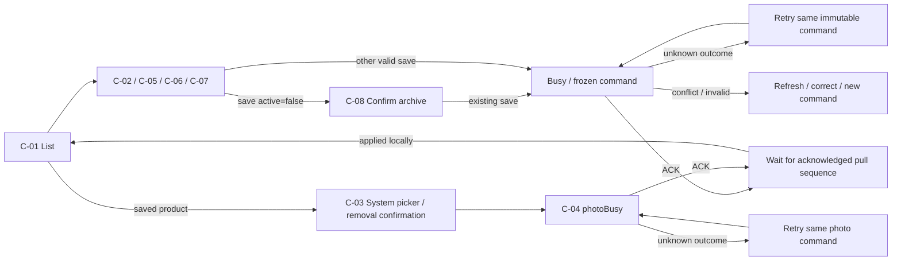

# Catalog — detailed screen designs

15 November 2026 · C-01–C-08 · Daun Teh Nusantara / Asterfed

Design handoff now applied to the native catalog presentation; device/hosted
acceptance remains open. See implementation status below. Open the
[phone/tablet reference](design/catalog-flow.html). Its data, picker and save results
are fictional local simulations; the reference does not perform Android/backend operations.
Static browser captures: [phone list](design/catalog-phone.png) and
[wide editor](design/catalog-tablet.png). These are fictional browser references,
not Android screenshots. Icons reuse the retained
[Material Symbols sources/license](MATERIAL_SYMBOLS_SOURCES.md).

Use the existing [visual tokens](UI_GUIDELINES.md),
[authenticated shell](SHELL_SCREEN_DESIGNS.md) and [photo boundaries](PRODUCT_PHOTOS.md).

## 1. Existing contracts and limits

| Source | Contract to preserve |
| --- | --- |
| [CatalogEditorScreen.kt](../app/src/main/java/com/dauntehnusantara/pos/feature/catalog/presentation/CatalogEditorScreen.kt) | Route callbacks: save, refresh, retry, pickPhoto, removePhoto, retryPhoto; current Category/Product/Group/Option forms |
| [CatalogEditorViewModel.kt](../app/src/main/java/com/dauntehnusantara/pos/feature/catalog/presentation/CatalogEditorViewModel.kt) | CatalogEditorState.editable, frozen pending commands, shared waitingThrough; no durable editor/photo outbox |
| [EditCatalog.kt](../app/src/main/java/com/dauntehnusantara/pos/feature/catalog/domain/EditCatalog.kt) | UUID IDs/operation, expectedVersion, trimmed 1–120-character name, nonnegative whole Long IDR, Int order/bounds, <=100 unique group IDs |
| [Catalog.kt](../app/src/main/java/com/dauntehnusantara/pos/feature/catalog/domain/Catalog.kt) | Product/category visibility, ordered assignments, active groups/options and min/max selection |
| [ProductPhotos.kt](../app/src/main/java/com/dauntehnusantara/pos/feature/catalog/photos/domain/ProductPhotos.kt) / [ProductPhoto.kt](../app/src/main/java/com/dauntehnusantara/pos/feature/catalog/photos/presentation/ProductPhoto.kt) | Independent photo revision/command, scoped image load, placeholder/retry |
| [schema.sql](../supabase/schema.sql) save_catalog_record | Live Owner/Manager/device/epoch checks, optimistic revisions, idempotent same-command retry, dependency rules and audit/feed transaction |

Owner/Manager edit the **brand-shared** catalog through the selected authorized
outlet. Cashier has no catalog management route; hiding controls never replaces RLS.
Never claim edits are limited to the selected outlet. Do not add stock, SKU/barcode,
discounts, tax, multi-brand choice, drag sorting, camera or interactive crop features.

`editable` is false while loading/offline/busy/photoBusy, a command is unresolved,
waitingThrough is non-null, initial pull is incomplete/errored, or epoch is absent.
Use that existing predicate for **every** add/edit/archive/reactivate/photo mutation.
Read cached catalog under existing authority; first catch-up/recovery blocks edits.

## 2. Adaptive structure

| Surface | Compact <600dp | Medium / constrained tablet | Wide window |
| --- | --- | --- | --- |
| Catalog C-01 | Single scrolling list, 16dp gutters | List with 24dp gutters | Bounded list; retain shared rail/header |
| Four tabs | Horizontal scrollable labeled tabs | Same | Same, not a vertical chip stack |
| Form C-02/C-05–07 | Focused full-height form presentation with scroll and IME-safe action area | Dialog max560dp | At >=1100dp **available content** width, list + 440–560dp editor pane if both fit; otherwise dialog |
| Archive/remove confirmation | Sheet | Dialog max560dp | Dialog |
| Large text / short window | One column; grow labels; scroll controls | Prefer focused form if dialog cannot fit | Collapse split pane; keep field state mounted |

Width is measured after shared navigation/insets, not hardware identity. Switching
layout must preserve input, scroll/focus and frozen commands. Do not make a new auth
route for each design ID. Shared outlet/role/access header remains outside catalog;
catalog owns its title, shared-brand notice and operational state.

## 3. C-01 — Catalog list

Hierarchy:

```text
[existing outlet / role / access header]
Katalog                                      [+ Tambah produk]
Perubahan berlaku untuk seluruh outlet Daun Teh Nusantara.
[loading / offline / command / refresh status]
[Produk] [Kategori] [Grup pilihan] [Pilihan] → scrollable
[Cari nama…]                      [Semua | Aktif | Arsip]
[thumbnail] Teh Melati             Rp 6.000
            Teh original · Aktif               Edit
```

- Default tab **Produk** replaces the prior Category-first presentation. Local tab/search/status filters do not introduce a query API. Case-folded
  name search only; counts describe the displayed cache, not total server inventory.
- Row grouping: clear name, relevant parent/category, active/archive label, formatted
  integer IDR where relevant, one Edit action. Photo action belongs to product context,
  not equally prominent upload/remove buttons on every row. No raw enum/version code
  as the primary user label; retain revisions internally for commands.
- Show all matching administrative records, including inactive ones. An active product
  whose category is archived is labeled “Kategori diarsipkan”; do not falsely label
  the product itself archived. That product is unavailable to new POS selection.
- Empty catalog differs from no search/filter results. Empty product setup guides to
  an active category first; no matching rows offers “Hapus pencarian/filter”.
- Refresh invokes existing retrySync; disabled while work is busy as appropriate.
  Refresh is a nudge, not guaranteed immediate success or permission to discard pending
  work. Do not offer it as a substitute for retryCommand/retryPhoto.
- Cached offline list has a neutral “Offline · hanya lihat” notice and disabled edit
  actions. Missing/failed photos do not make the list or checkout unusable.

## 4. Forms and exact field meaning

All forms: persistent labels; 48dp targets; 120-character name guidance; inputMode /
keyboard appropriate to numbers; explicit field errors and a reachable primary save.
Use Rp prefix and raw whole digits on entry, format IDR on rows/summary. Zero is valid.
Do not round overflow, accept decimals/negative amounts or impose an invented price cap.
CatalogMutation uses Long for money and Int for order/bounds; parse safely and surface
invalid/overflow rather than silently substituting zero. Client checks are guidance;
server validation remains authoritative.

### C-02 — Product

1. Name, active status (new default active), category radio/selector.
2. Base price in integer IDR.
3. Optional assigned groups: label min/max, ordered existing selection, checkboxes.
4. Existing-product photo context (C-03); new product says “Simpan produk sebelum
   menambahkan foto”. No picker/upload before acknowledged product creation and pull.
5. Save + cancel; existing active product also has a separate archive action below
   ordinary save. Switching active->inactive invokes C-08 before submission.

Only active categories are fresh choices; show an existing archived parent with a
warning, never silently move the product. An active product needs an active parent
before saving. Already assigned archived groups remain visible for context/removal;
never offer an archived group as a fresh assignment. Preserve existing group order;
append new choices instead of inventing drag reordering.

A product may have no groups. If an active assigned group requires options, sufficient
active options must exist before the server accepts the assignment. Guide users to
create the group, then its options, then assign it; do not silently lower minimums.

### C-05 — Category

Name, display order (nonnegative Int), active status. Order is a numeric field,
not a drag-and-drop feature. Archive warning explains its active products stop
appearing for new cashier selection; it does not physically delete child products.
Reactivation still uses an expected-version command and can fail on stale data.

### C-06 — Group

Name, minimum selections (>=0), maximum (>0 and >=minimum), active status. Show a
plain-language preview: “Opsional · pilih hingga 2” or “Wajib · pilih 1–2”. This is
informational, not an extra configuration flag. Do not require maximum <= current
option count: that is not an existing contract. The server rejects an active,
assigned group if active options cannot satisfy its minimum.

### C-07 — Option

Name, additional whole-IDR price (>=0), parent group, active status. Zero means
“Tanpa tambahan biaya”. Choose an active group when creating. Existing option's
parent is **read-only**, with “Grup tidak dapat diubah setelah dibuat”; no misleading
selectable radio list or move-between-groups mutation. Empty groups guide to group
creation first. Archiving a required option can be rejected when too few active
options remain for an assigned group's minimum; keep an actionable dependency message.

## 5. C-03/C-04 — Photos

On a saved product, show optional image, “Tambah foto” or “Ganti foto”, and separate
“Hapus foto” confirmation. Removal changes only the image reference; it is not product
archive and does not physically delete historical Storage bytes. Use existing
removePhoto(product), independent imageVersion and PhotoCommand; do not bump price
revision or place bytes in sales/outbox/receipts.

- System Photo Picker is X-02, OS-owned. Cancel makes no change. Reference illustrates
  this boundary with a fictional choice; it never reads a real gallery/file.
- Existing preparation: centered automatic square crop, EXIF orientation, 512×512 JPEG
  <=200KiB, bounded original input (16MiB /40MP). Do not promise manual crop/zoom/camera,
  show an upload percent without measurements, or put “200KiB original” on picker help.
- Current state exposes photoBusy, not detailed transfer phases. Show “Memproses foto…”
  with indeterminate progress. Waiting for local pull is a distinct observed state.
- Private scoped cache supports only previously downloaded/retained bytes offline;
  cache/OS eviction is normal. Missing photo -> placeholder + “Muat foto” retry, never
  disable a product card, payment or original receipt.
- Photo conflict: refresh and review latest photo/version before selecting again.
  Terminal invalid/auth/recovery errors clear the command per ViewModel; uncertain
  errors retain UUID/path/bytes and expose only same-command retry while in memory.
- New selection/removal is disabled while a catalog/photo command is unresolved or
  waiting for pull. Do not combine product and photo writes into one invented atomic save.

## 6. Save, errors, archive and lifetime

| Existing state | Presentation / allowed action |
| --- | --- |
| loading / no initialized pull or epoch | “Menyiapkan katalog…”; read placeholders/cache, no mutation |
| offline | “Offline · hanya lihat”; retained catalog, no queued admin edit promise |
| busy | “Menyimpan perubahan…”; freeze repeated save/dismiss while submission is active |
| pending != null and not busy | “Hasil penyimpanan belum dapat dipastikan”; retry **same frozen command**, block editing/new commands |
| photoCommand != null and not photoBusy | Separate photo retry, original path/bytes/version/UUID; no new picker/remove |
| waitingThrough != null | “Perubahan diterima server. Memperbarui katalog di perangkat…”; refresh/pull nudge, no mutation |
| saved and local pull applied | “Katalog di perangkat sudah diperbarui”; not a server backup claim |
| CONFLICT | No overwrite/retry stale mutation. Refresh latest, review and explicitly create a new command |
| INVALID | Field/dependency guidance, no blanket same-command retry. Correct draft and create a new command |
| AUTH_REQUIRED | Existing online validation/sign-in path; cannot override with cached role |
| REBOOTSTRAP_REQUIRED | Stop edits; settings/recovery guidance; never clear data/reset cursor from catalog |
| UNAVAILABLE / INVALID_RESPONSE with retained command | Preserve uncertainty and retry identity; no claimed success |
| photo INVALID_IMAGE | Explain supported image/bounds, choose a different source after terminal preparation failure |

C-08 confirmation names the exact record and brand-wide impact. Primary “Arsipkan”,
secondary “Batal”. A dedicated archive action preserves stored fields; explain that
unsaved form edits are not included. Saving a form with active switched off explicitly
confirms “Arsipkan dan simpan” including those edits. Cancellation preserves the draft.
Preserve ID, relationships and expected version;
submit **active=false through existing save**, with a newly created operation UUID
for this new command. No DELETE RPC, cascading mutation or automatic reprice. Parent/
minimum constraints can still reject archive. Reactivation is active=true through
that same existing contract, not restoration of physically deleted rows.

Input lifetime replaces the prior form behavior that closed immediately on save. Retain an editor draft in current scope during
submission/result review; freeze it while uncertain. After definitive INVALID let
users correct it; after CONFLICT require refreshed target/version and explicit review.
Never mutate a submitted command's payload under its operation UUID. Layout/IME
changes preserve draft state; account/outlet/role changes clear it. Do not persist a
photo command, secret or editor to SavedState/Room as an offline write queue. Process
loss requires refreshed catalog and inspection before recreating an uncertain edit.
Cancelling an untouched/local draft makes no server call. Dismissing UI cannot undo
an in-flight request; disable dismissal while busy and keep unresolved status visible.



## 7. Historical implementation gaps addressed by the native pass

The pre-redesign screen started on Category, used English enum chips/one AlertDialog
and closed the form on save; local search/status filters, archive confirmation and the
adaptive editor/draft lifetime were the presentation work scoped for this iteration. Do not change server rules
to make a preview variant look successful.

The prior `retrySync()` only enqueued work and restarted failed observation; it does not
acknowledge completed network refresh or clear every error by itself. Implement an
observed refresh/result state (using actual pull progress/success) before claiming a
conflict's latest snapshot is ready. Until then, label refresh as requested, preserve
conflict context and rely on expected-version/server validation rather than inventing
freshness. Draft/result correlation may need additional memory-only ViewModel state;
keep the existing endpoints and immutable request contracts. In the reference only,
“Muat ulang” after a fixture conflict simulates a completed refresh.

## 8. Native implementation tickets and acceptance

1. **CAT-UI-01:** localized scrollable tabs, row hierarchy, cached list search/status,
   shared-brand/empty/no-match/bootstrap/offline/error states. Keep shell integration.
2. **CAT-UI-02:** adaptive product/category/group/option editor, field errors, parent
   locks, group assignment order and input/IME/scope lifetime. No new business field.
3. **CAT-UI-03:** archive/reactivate/remove-photo confirmations, immutable pending
   command handling and explicit conflict/unknown-result recovery using existing callbacks.
4. **CAT-UI-04:** photo context, picker cancellation, busy/unknown/waiting-pull separation,
   placeholder/retry and existing scoped cache boundaries.
5. **CAT-UI-05:** domain/ViewModel/Compose regressions + compact/medium/tablet, 200%
   text, short window, IME/rotation/TalkBack and hosted two-device acceptance.

Required cases: no active category/group; zero price; decimal/negative/Long overflow;
name blank/>120; Int overflow; invalid min/max; insufficient required options; archived
parent/assigned group; immutable option parent; empty versus no-match; archive cancel,
stale target and dependent-option refusal; photo picker cancel/missing/invalid/cache
loss; lost ACK same operation; no editing during unknown/pull wait; process loss and
scope change; cashier route denial; original paid snapshots unchanged. Extend existing
CatalogHardeningTest, CatalogEditorScreenTest, ProductPhotoScreenTest and photo/repository
coverage when implementing; prototype checks are not backend or Android acceptance.

## 9. Native implementation status

CAT-UI-01–04 are implemented in CatalogEditorScreen.kt, CatalogEditorForm.kt,
CatalogEditorSession.kt and CatalogEditorViewModel.kt. The historical gap section
above describes what this iteration addressed: raw draft/result memory, explicit
conflict review, observed refresh state and adaptive forms now exist. No API, Room
schema, dependency version, sale snapshot or auth policy changed.

Drafts/scroll survive activity rotation while its ViewModel lives; account/outlet/
role changes/logout clear presentation state. Process loss still loses an editor or
uncertain admin command: inspect a refreshed catalog before creating another command.
This is not a durable admin outbox or a guarantee against duplicate catalog creation
after recreating a lost command. Sale delivery retains its independent durable outbox.

Host regression coverage and instrumented test compilation do not verify the real OS
picker, IME/insets/rotation, TalkBack, hosted Storage or concurrent devices. Execute
these manual scenarios with provisioned test users before release:

1. Phone/medium/tablet/large text: create/edit all four record types, keep the save
   action visible with IME, resize/rotate with typed text, and confirm scope change
   clears it. Check wide list cannot replace an open form silently.
2. Test invalid/zero/overflow values and insufficient options/archived parents.
   Archive/cancel and reactivate; confirm option parent stays immutable and category
   archive affects new selection without rewriting paid receipts.
3. Interrupt save/ACK: retry the same command, keep all new edits disabled, then wait
   for local target data before declaring completion. Conflict refresh must observe
   actual pull success and require explicit replacement/review of stale form input.
4. Pick/cancel/replace/remove a photo and change access while picker/IO is open.
   Photo operations preserve typed product fields and price revision; test invalid,
   missing, offline cached and evicted images. No image problem may block checkout.
5. With slow IO, switch outlet/account and verify old data never appears under the
   new scope; sign-out clears editor state. Recheck real server role/device/RLS guards.
