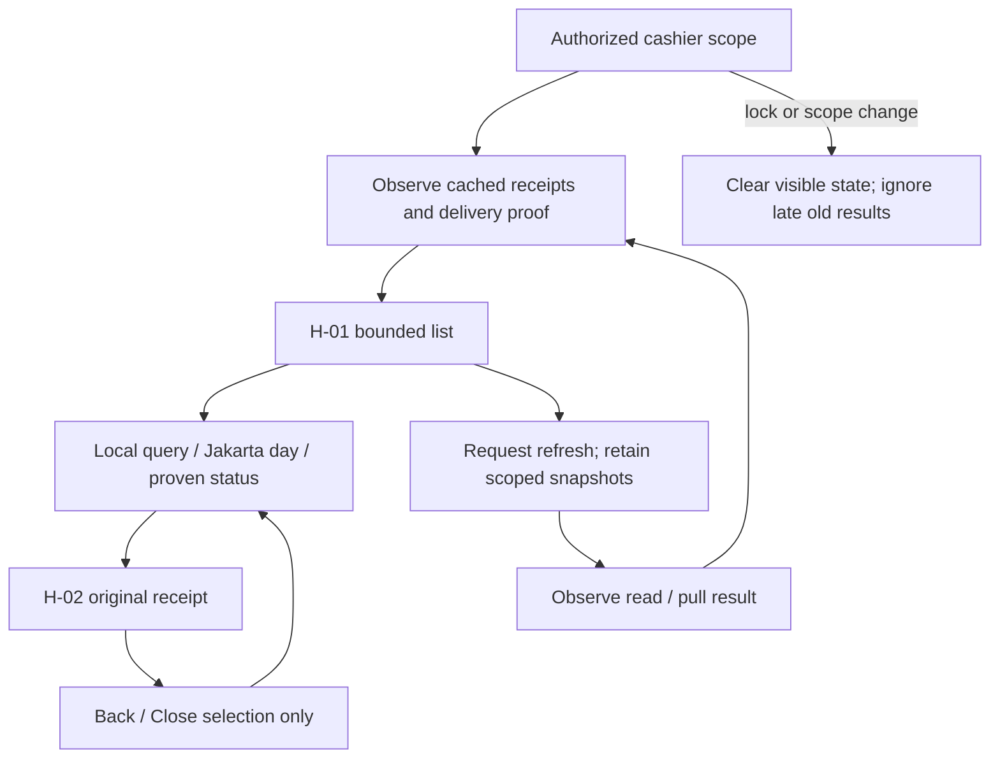

# History — detailed screen designs

15 November 2026 · H-01 / H-02 · Daun Teh Nusantara / Asterfed

Design handoff and native implementation reference. The
[interactive phone/tablet reference](design/history-flow.html) uses fictional
receipts and outcomes held only in browser memory. The HTML remains a fictional reference: it neither reads a real account nor records,
pays, refunds, retries or synchronizes a real sale. Native implementation status
and remaining manual acceptance are recorded below.

Follow [UI_GUIDELINES.md](UI_GUIDELINES.md), [SHELL_SCREEN_DESIGNS.md](SHELL_SCREEN_DESIGNS.md)
and [POS_SCREEN_DESIGNS.md](POS_SCREEN_DESIGNS.md). Reuse the white canvas, tea-green
selection, restrained neutral grouping, Material Symbols and immutable receipt hierarchy.
Icon attribution: [MATERIAL_SYMBOLS_SOURCES.md](MATERIAL_SYMBOLS_SOURCES.md).
Static fictional captures: [tablet list/detail](design/history-tablet.png) and
[phone receipt review](design/history-phone.png).

## 1. Existing contracts and scope

The table records the pre-redesign baseline; section 7 describes the delivered native implementation.

| Source | Preserve / implication |
| --- | --- |
| [Auth.kt](../app/src/main/java/com/dauntehnusantara/pos/feature/auth/domain/Auth.kt) | Cashier navigation is Kasir / Riwayat / Setelan. No new Owner/Manager history route or outlet selector inside history. |
| [AuthenticatedPosRoute.kt](../app/src/main/java/com/dauntehnusantara/pos/feature/pos/presentation/AuthenticatedPosRoute.kt) | HISTORY currently calls HistoryContent(state, retry, demo=false). Expanded mode is not yet passed into history. |
| [PosScreen.kt](../app/src/main/java/com/dauntehnusantara/pos/feature/pos/presentation/PosScreen.kt) | Current history has loading/error/empty/catch-up notices, simple cards and an AlertDialog detail; selection is scope-keyed. No current search/date/status controls. |
| [AuthenticatedPosViewModel.kt](../app/src/main/java/com/dauntehnusantara/pos/feature/pos/presentation/AuthenticatedPosViewModel.kt) / [PosViewModel.kt](../app/src/main/java/com/dauntehnusantara/pos/feature/pos/presentation/PosViewModel.kt) | Scoped history and checkout/delivery read state share observation. Keep generation guards, unknown local-save command state and the explicit debug-demo boundary. |
| [AuthenticatedCheckoutRepository.kt](../app/src/main/java/com/dauntehnusantara/pos/feature/checkout/data/AuthenticatedCheckoutRepository.kt) | Current authority/backend checks; local + scoped downloaded receipts; UUID dedupe with local precedence; createdAt descending then ID ascending; final take(100). |
| [CheckoutDao.kt](../app/src/main/java/com/dauntehnusantara/pos/core/database/CheckoutDao.kt) / [PullEntities.kt](../app/src/main/java/com/dauntehnusantara/pos/core/database/PullEntities.kt) | Local query already caps at 100 by created time/ID descending. Remote cache query caps at 100 by feed sequence descending. There is no history pagination contract here. |
| [Checkout.kt](../app/src/main/java/com/dauntehnusantara/pos/feature/checkout/domain/Checkout.kt) | Immutable Receipt snapshots; separate ReceiptDelivery map; no receipt origin/display cashier name/number fields. |
| [PosCheckout.kt](../app/src/main/java/com/dauntehnusantara/pos/feature/pos/presentation/PosCheckout.kt) | Reuse original lines/modifiers/price/payment, Jakarta time and delivery labels; history detail must not get next-sale or checkout actions. |
| [Formatting.kt](../app/src/main/java/com/dauntehnusantara/pos/core/designsystem/Formatting.kt) | Integer IDR; format UTC epoch timestamps in Asia/Jakarta, independently of device zone. |

History is the current cashier's own authorized receipts in the selected outlet,
including available receipts downloaded from that cashier's other devices. Server
RLS/feed and repository guards enforce this; filters never grant access. Owner and
Manager reporting remains their existing route. Valid offline authority allows cached
reads under the existing lease; being offline does not extend it or bypass a lock.

**Bounded cache, not complete archive:** say “Hingga 100 struk dari cache yang tersedia.
Pencarian dan filter hanya mencakup data ini.” Do not say “100 transaksi terbaru” as
a global guarantee: the remote input is capped by feed sequence, which can differ
from sale creation order, and local tie-boundary ordering also differs from merged
ordering. Do not invent load-more/server search, claim an older date has no sales,
or show cache amounts as accepted revenue/daily totals. Counts are “struk ditampilkan”,
not complete outlet transaction counts. No changes to query limits/schema are needed
for this presentation milestone; comprehensive archive browsing is separate work.

## 2. Adaptive structure

| Surface | Compact / constrained | Expanded, with enough available width |
| --- | --- | --- |
| H-01 list | Title and refresh, scope/cache notices, search, stacked date/status controls, date-grouped rows | List/filters pane (~360–440dp minimum) and bounded detail pane; keep list state while selecting |
| H-02 detail | Focused scrolling detail with “Kembali ke riwayat”; Back returns to existing filters/scroll | Detail pane beside list; unselected state asks to choose a receipt; Close clears selection |
| Large text / short / split window | Collapse to focused list/detail; controls wrap, fields scroll above IME | Do not force two panes simply because the outer device is a tablet |

Reuse the shell's single outlet/role/access header. Feature title is “Riwayat” with
subtitle “Struk saya di outlet ini”. Existing >=840dp window category alone is not
a promise of two panes: proposed history threshold >=1000dp available content width
and text <150%, subject to native measurement. At large text or narrow split screen,
use focused detail without resetting selected ID or query. Do not mount separate
state owners for phone/tablet branches. Browser reference uses content width, not
hardware type; its CSS pixels are illustrative, not Android dp acceptance evidence.

## 3. H-01 — Browse and filter

Hierarchy: Riwayat → scoped subtitle → cache/readiness/refresh notice → local search
→ date/status controls → matching displayed count → Jakarta date headings → rows.
Keep green for selected controls; statuses always have readable words.

- Search label “Cari ID struk atau nama minuman”. Match a trimmed, case-insensitive
  substring of the full public receipt UUID or **original product-name snapshots**.
  No current-catalog lookup, email, device secret, fuzzy server search or receipt
  number fabrication. A shortened trailing ID on a row is a display hint only;
  full UUID stays searchable and visible in detail. Empty query matches all cached rows.
- Date choices: Semua tanggal / Hari ini / Kemarin. Compute day boundaries in
  Asia/Jakarta using the injected clock; intervals are [start, nextStart), across
  month/year boundaries. “Today” updates while the screen stays open across midnight.
  No unrestricted range picker or pagination implied. Older cached dates remain
  visible under Semua; no-match copy still explains the cache limit.
- Delivery choices: Semua status / Menunggu kirim / Pengiriman belum pasti /
  Diterima server / Perlu ditinjau / Validasi akses / Status belum tersedia.
  Derive status from the matching scoped delivery projection; missing metadata means
  UNKNOWN even when aggregate pending count is zero or a pull just completed.
- Combine query/date/status with AND; filter only after authorized merge/dedupe.
  Preserve repository order within Jakarta date groups; do not reverse ties again
  in UI. Use receipt UUID as list key. A local/feed echo of the same sale is one row.
- Row: original first product name plus “+N baris lain” if needed, quantity sum labeled
  item, Jakarta time, cash / QRIS manual, shortened public UUID, strongest total,
  readable delivery state and a single clear “Lihat struk” selection target.
  Rows are at least 48dp actionable and can grow for long names/large amounts.
- Empty healthy cache: “Belum ada struk di cache ini”; explain refresh can fetch
  available authorized data. Empty filtered result: “Tidak ada struk yang cocok
  dalam cache ini”, with “Hapus pencarian/filter”. Clearing filters never deletes data.

Proposed local filter/selection state survives layout/rotation and same-scope navigation
when feasible. Clear before slow old work completes on account, outlet, backend,
device, role or locked-access changes. Do not restore broader cached selections after
role change. Retain list scroll when returning from detail. Same-scope refresh retains
filters; if selected ID drops out of the current filtered/bounded snapshot, clear
selection and explain “Struk tidak lagi ada pada daftar ini”; do not silently select
another or delete the underlying sale. A filter change uses the same rule.

## 4. Read, refresh, error and recovery states

| State | Display / allowed action |
| --- | --- |
| Initial local loading, no rows | Progress with “Membaca struk di perangkat…”; no empty-success claim |
| Healthy empty cache | Scoped empty copy; refresh available under current authority |
| Initial catch-up incomplete | Explain remote history may be incomplete; any already authorized cached receipt remains viewable; no implication checkout is enabled |
| Valid offline / temporary pull failure | Retain authorized cached list/detail; notice and refresh route; access mode and actual delivery status remain distinct |
| Local read failure, no rows | Error and “Coba baca lagi”; never “no sales” |
| Local read failure with same-scope retained rows | Keep last successfully read snapshots with stale/read-error notice; permit read-only detail, missing delivery proof stays unknown |
| Refresh requested | “Memperbarui…”, disable repeat request; retain rows/filters/detail; scheduler enqueue is not completion |
| Observed successful local read | Clear local-read error only; does not prove pull/cloud acceptance |
| Observed successful pull | Update refresh indicator only after a new successful PullStatus observation; recompute rows/labels from Room, not guessed acknowledgment |
| Refresh failure | Keep snapshots; readable failure/retry; never success toast on scheduling |
| Restored-feed recovery | “Jangan hapus data aplikasi”; keep authorized retained receipts readable, route to existing Setelan recovery; no cursor reset/rebootstrap/delete-sale button |
| Locked/sign-out/new scope | Clear rows, detail, filters and stale result callbacks immediately; existing auth flow owns unlock/revalidation |

**Baseline gap addressed by the native iteration:** history used the shared retry callback, which schedules and
restarts observation without an explicit refresh lifecycle or a last-success timestamp
in PosUiState. Implement request/read/pull outcome correlation, not a timer or spinner
that ends after enqueue. Cached display may be retained only within the same still-
authorized scope. Avoid erasing a pending POS command or dismissing its receipt merely
to view/close history. A list read must not become a checkout readiness override.

## 5. H-02 — Original receipt detail

Use the current immutable receipt hierarchy in a focused readable column (max~620dp):
Struk penjualan → “Struk tersedia di perangkat” → original ID/time → original lines,
modifier names/deltas, quantity × unit price and line totals → total → method/tender/
change/manual QRIS explanation → proven delivery or review → Back/Close.

“Struk tersedia di perangkat” applies to both a locally created receipt and a downloaded
cached receipt; it does not assert it was created on this device. Existing Receipt
has no provenance field, so do not invent “dibuat di sini”, origin filters, staff names,
sequential receipt numbers, outlet names resolved from current mutable catalog data,
or a bank-verification checkmark. The shell already identifies the authorized outlet.
Show immutable full UUID (wrap/selectable in native) and Jakarta date/time. No product
photos are needed; later catalog edits, archives or deleted images cannot rewrite detail.

| Delivery evidence | Detail label / action |
| --- | --- |
| PENDING | Menunggu kirim; saved/available locally, acceptance not confirmed |
| RETRY | Pengiriman belum pasti; original queued payload remains unchanged |
| SYNCED | Diterima server; not a backup or bank QRIS settlement guarantee |
| REVIEW + catalogChanged | Perlu ditinjau · katalog berubah; contact authorized operator; keep original price/payment |
| Other REVIEW | Perlu ditinjau; generic safe explanation, no raw response/PII/error payload |
| AUTH_REQUIRED | Pengiriman menunggu validasi akses; existing Setelan/revalidation route |
| Absent / UNKNOWN | Status pengiriman belum tersedia; never infer from queue totals |

In this history milestone, refresh is a **read/sync nudge**, not a selected-sale
resubmission. Keep per-receipt retry out of detail; existing settings/POS can request
current account/device/outlet queue retry under existing policy. Provide no mark-synced,
change-price, charge-again, next-sale, delete, refund, void, share/export or print action.
Closing history detail clears only UI selection; it must not call dismissReceipt,
complete checkout, alter the cart, or clear the last-receipt pointer. Review remains
read-only; price rejection is never an excuse to reissue the paid sale.

## 6. Implementation tickets and acceptance

1. **HIST-UI-01:** scoped history presentation state and selectors (cached UUID/name,
   Jakarta date/status filters, stable merge order, selected ID/scroll). Reuse domain
   Receipt/ReceiptDelivery and repository guards; no schema/RPC change assumed.
2. **HIST-UI-02:** adaptive H-01 list/H-02 focused or split detail; readable total/status,
   cache-limited count, loading/empty/no-match/read-error/recovery states, Back and focus.
   Reuse receipt content while separating the history availability banner/action set.
3. **HIST-UI-03:** observed local-read/pull refresh lifecycle, retained same-scope
   snapshots, scope cancellation and selected-row eviction. Protect existing pending
   checkout/last-receipt state and auth gating; scheduling cannot claim completion.
4. **HIST-UI-04:** selector/time-boundary/scope/refresh/ViewModel regressions, DAO merge/
   dedupe/read-only invariants and compact/expanded/large-text Compose checks. Build
   debug/release and compile instrumented tests; physical/hosted acceptance remains separate.

Acceptance includes same receipt echoed by feed once; local/remote input limits and
honest cache copy; UUID and original-name search after catalog rename; AND filters;
Jakarta UTC+7 midnight/month/year boundaries and open-screen day rollover; stable tie
ordering; zero/large IDR totals; original cash/change/QRIS manual distinction; all six
delivery states with missing-proof fallback; no aggregate-count inference; refresh
request/failure/new observed success and offline retention; scope/role/device/backend
changes during IO; known recovery receipt viewing; selection eviction without deletion;
Back/Close never modifying draft, pending command, receipt pointer or outbox; compact,
medium, split/tablet, short height, 200% text, IME, focus/TalkBack and rotation.

The HTML reference demonstrates UI fixtures only. It cannot validate Room persistence,
lease/Keystore enforcement, RLS, multi-device server history completeness or payment.
Exact next milestone: implement HIST-UI-01–04 as one native history presentation iteration.

## 7. Native implementation — 15 November 2026

HIST-UI-01–03 are implemented, with HIST-UI-04 verification in PROGRESS.md.

- `feature/history/presentation/HistorySession.kt` owns same-scope in-memory query,
  Jakarta day/status selection, receipt selection and list scroll. Selectors keep
  repository order and original names. Missing receipt evidence is UNKNOWN.
  A Clock-driven ticker updates the date at Jakarta midnight and checks clock
  changes at least once per minute. Old UI callbacks have a session generation guard.
- `HistoryViewModel.kt` owns separate authorized cashier reads and refresh jobs. It
  does not call add/quantity/remove/complete/dismissReceipt. Scope generations clear
  visible snapshots and inputs before cancellation, and post-read scope validation
  rejects device/backend changes even without an auth identity emission.
- Refresh first reads local state, then (online and outside restored-feed recovery)
  awaits the existing bounded `PullRepository.sync()` call and re-reads Room/status.
  A successful owned pull plus successful initialized status can finish even when
  lastSuccessMs is unchanged; an old timestamp or enqueue alone cannot finish it.
  Partial pulls have their own outcome and request existing worker continuation.
  Offline/recovery is explicitly local-only; failure retains still-authorized
  snapshots. No endpoint, schema, migration, retry-state reset or archive expansion.
- `HistoryScreen.kt` uses a 420dp list beside bounded detail at >=1000dp available
  width, >=480dp height and text <150%; constrained/large-text windows use focused
  detail with Back/Close and list scroll retained. Search/filter controls scroll
  with the list so short windows/IME can reach them. Native role routes are unchanged.
- Shared `ReceiptContent(history=true)` displays local availability, selectable full
  UUID and original immutable values, and suppresses checkout/queue actions. Closing
  detail changes selection only. QRIS copy explicitly distinguishes manual checking
  from bank verification. Debug-only local history also uses the new presentation.

Physical/manual acceptance beyond the automated component tests:

1. Sign in as an approved cashier, record a local sale, then open Riwayat. Search
   using its full UUID and original product name; try date/status intersections and
   no-match reset. Confirm count/copy never claims complete outlet history or revenue.
2. Read cash/zero/QRIS manual receipts, including original modifiers. Return to Kasir:
   the draft, unresolved payment command or undismissed checkout receipt must remain
   intact. Review has no reprice/resubmit/delete/charge-again action.
3. Refresh under valid offline access, slow/failed network, complete and partial
   pull, and restored-feed recovery. Local-only and partial outcomes must not claim
   accepted delivery or complete archive. Reconnect labels require actual ACK/feed.
4. Switch role/account/outlet while reads are delayed; old rows/selection/inputs must
   clear before completion. Repeat on an actual tablet/split window and a phone with
   200% text, numeric/text IME, rotation and TalkBack. Detail/list scrolling and focus
   need physical acceptance; host emulation alone is insufficient.

Presentation state is memory-only; Room receipts/cart/outbox remain durable. No new
production build type, permission, schema or third-party library was introduced.
The component-test runner uses a plain Application to skip normal startup sync;
these fixture tests do not exercise Hilt MainActivity/login/Keystore or hosted RLS.
Those end-to-end tests require their own normal-application acceptance setup.

Exact next milestone: detailed R-01–R-03 overview/report/filter designs before native
report redesign. Keep existing accepted-server report metrics and X-03 export contract.
