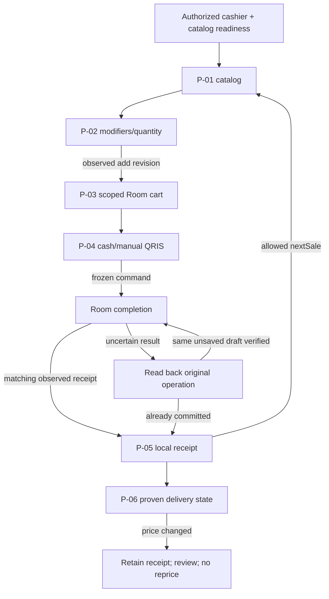

# POS — detailed screen designs

15 November 2026 · P-01–P-06 · Daun Teh Nusantara / Asterfed

Design handoff for the next native iteration. The [interactive reference](design/pos-flow.html)
uses fictional products, identity, checkout and transport outcomes in browser memory.
It never saves a real sale, opens a bank app, verifies QRIS or contacts Supabase.
The HTML remains a fictional design reference. Native implementation status and
manual acceptance are recorded below.

Static fictional captures: [tablet catalog/cart](design/pos-tablet.png) and
[phone receipt/review](design/pos-phone.png). Icons reuse the retained
[Material Symbols sources and license](MATERIAL_SYMBOLS_SOURCES.md).

Use [UI_GUIDELINES.md](UI_GUIDELINES.md), the existing
[SHELL_SCREEN_DESIGNS.md](SHELL_SCREEN_DESIGNS.md), and
[SYNC_PROTOCOL.md](SYNC_PROTOCOL.md). Scope is cashier presentation, not payment
integration, refunds, tax, inventory, discounts, printing or a new role permission.

## 1. Source contracts

| Existing source | Preserve |
| --- | --- |
| [PosScreen.kt](../app/src/main/java/com/dauntehnusantara/pos/feature/pos/presentation/PosScreen.kt) | PosActions retry/add/quantity/remove/pay/next/clearError; selection/cart/payment/receipt surfaces |
| [PosViewModel.kt](../app/src/main/java/com/dauntehnusantara/pos/feature/pos/presentation/PosViewModel.kt) | PosUiState / PosError; debug demo stays distinct from authenticated operation |
| [AuthenticatedPosViewModel.kt](../app/src/main/java/com/dauntehnusantara/pos/feature/pos/presentation/AuthenticatedPosViewModel.kt) / [AuthenticatedPosRoute.kt](../app/src/main/java/com/dauntehnusantara/pos/feature/pos/presentation/AuthenticatedPosRoute.kt) | Current auth/scope, observed Room draft/receipt, pull gate, existing route callbacks |
| [Checkout.kt](../app/src/main/java/com/dauntehnusantara/pos/feature/checkout/domain/Checkout.kt) | Snapshot lines, integer IDR with checked arithmetic, quantity 1–999, <=100 separate lines; cash/manual QRIS validation |
| [AuthenticatedCheckoutRepository.kt](../app/src/main/java/com/dauntehnusantara/pos/feature/checkout/data/AuthenticatedCheckoutRepository.kt) | Scope/auth/initialized-cursor guard; Room revision check; sale graph + outbox + rotated draft/last-receipt pointer atomically committed |
| [PushSync.kt](../app/src/main/java/com/dauntehnusantara/pos/feature/sync/domain/PushSync.kt) / [RoomSyncRepository.kt](../app/src/main/java/com/dauntehnusantara/pos/feature/sync/data/RoomSyncRepository.kt) | PENDING/RETRY/AUTH_REQUIRED/REVIEW/SYNCED; stable payload/operation and acknowledged delivery |
| [SyncStatusPanel.kt](../app/src/main/java/com/dauntehnusantara/pos/feature/sync/presentation/SyncStatusPanel.kt) | Existing scoped aggregate status/retry; not per-receipt delivery proof |

Cashier starts at Kasir and retains own scoped history/settings. Owner/Manager keep
their current management navigation; a style pass must not add their POS access.
Server/device/offline authorization remains authoritative. First catch-up and restored-
feed recovery block new sale mutations. Valid existing offline authority can use the
initialized local catalog; image failure never grants or denies checkout authority.

## 2. Adaptive structure and shared shell

| Surface | Compact phone | Medium/constrained window | Expanded window |
| --- | --- | --- | --- |
| P-01 Catalog | Adaptive 1–2 column cards; bottom cart summary | More columns only when text/controls fit | Existing >=840dp expanded mode; catalog and 300–360dp cart if both fit |
| P-02 Selection | Scrolling sheet, pinned Add | Bounded dialog/sheet | Bounded dialog; do not stretch across tablet |
| P-03 Cart | Focused cart/sheet, reachable total/action | Focused cart if two panes cannot fit | Persistent cart pane, independently scrollable lines |
| P-04 Payment | Focused single form, pinned save + IME insets | Form max560dp | Focused payment with bounded order summary; prevent catalog edits during submit |
| P-05/06 Receipt/status | Scrolling immutable receipt | Bounded readable content | Same receipt hierarchy; no tablet-only behavior |

Use available width after navigation/insets and readable text size. Expanded mode is
not a promise two panes always fit. At large text, short windows or narrow split screen,
collapse panes without discarding persisted draft or typed payment/selection state.
Keep shared outlet/role/access header once; the feature owns Kasir and operational
states. Font/keyboard/layout changes must not remount editable content unnecessarily.

## 3. P-01 — Product catalog and readiness

Hierarchy: Kasir title, known catalog/pull state, local name search, scrollable category
filters, product grid and compact cart summary. Name/category filters are proposed
cache-only UI additions, not server search endpoints. Count cart items as summed
quantities; label separate lines as “baris” if showing draft.lines.size.

Cards: optional square image, name, category when useful, **Harga dasar** in formatted
IDR and one selection action. Do not say “Mulai Rp…” if required modifiers make the
base price unattainable. Show active products under active categories using existing
visibleProducts; keep option/group activity/assignment rules. Missing images offer a
placeholder/retry with 48dp targets; successful cached images are optional offline.

| State | Presentation / action |
| --- | --- |
| Loading/local read error | Progress or “Data belum dapat dibaca”; retry; no invented empty success |
| First catalog pull incomplete | “Sinkronkan katalog secara online sebelum membuat penjualan”; block add/cart mutation/payment |
| Initialized catalog, temporary pull failure | Non-blocking notice/retry if existing authority remains valid; current cached data subject to checkout's local catalog check |
| Recovery generation mismatch | Explain retained data, Setelan/recovery/export; no new sales or clear-data/reset cursor action |
| Healthy empty catalog | “Belum ada minuman tersedia. Hubungi pengelola”; no cashier catalog creation action |
| No search/filter results | Clear filters; do not imply catalog empty |
| Eligible offline | Neutral access label; local sale can be recorded under existing lease; no online enrollment/lease extension |

A receipt/retained history is distinct from permission to create another sale. Current
PosScreen checks syncRequired before receipt; the redesign should allow authorized
viewing of a known immutable receipt with the blocking recovery notice, while keeping
new-sale/dismiss/mutation guards. Do not weaken repository guards to make UI navigation work.

## 4. P-02 — Product/modifier selection

- Product name, base price, each active assigned group in assignment order, min/max
  guidance, option names and price deltas, quantity, computed line total and Add.
- Max=1 uses a radio/single-choice treatment; optional max=1 must still allow no option
  (e.g. explicit “Tanpa pilihan”). Do not auto-select a paid option or require optional
  groups. Multi-choice supports min..max; label the limit and prevent/report exceeding it.
- Only current active group/options appear. A required group with too few available
  options makes Add unavailable with a clear explanation; do not reduce the minimum.
- Quantity whole 1–999. Zero is invalid, not an implicit remove. Blank/overflow/too-large
  input keeps Add disabled. Use CheckoutRules.line for native amounts/constraints and
  catch arithmetic overflow without accepting rounded values.
- Add calls existing add(productId, selectedIds, quantity) once. Wait for observed
  successful draft revision/line before dismissing; keep selection after a failure.
  Current implementation closes the sheet immediately on callback: this is a gap.
- No replace-line/modifier-edit API exists. For an existing line, use quantity/remove;
  guide cashier to remove and choose again for different modifiers. Do not simulate
  a non-atomic remove+add as an in-place edit or merge distinct lines automatically.

## 5. P-03 — Cart and stale unpaid data

Each line shows snapshot product name, modifier names/deltas, quantity and line total.
Show unit price where it helps explain total. Plus/minus are labeled 48dp targets;
minus stops at 1, separate Remove removes the line. Disable mutations while busy and
honor stored draft revision. Total is strongest; checkout disabled for empty cart,
invalid/readiness state or unresolved local save.

Persisted Room cart survives process restart within its scoped identity. Unsaved
selection/payment UI has a different lifetime; never claim all typed fields are durable.
Cart can contain <=100 distinct lines, each 1–999; adding identical choices creates
another line in the current repository, not automatic merging.

If product/category/options/prices/versions change before local completion, existing
checkCatalog rejects the stale draft. Retain the cart, mark review and instruct removal/
reselection of affected lines. No silent repricing, global “accept new prices” action,
cart deletion or rewriting a paid receipt. Changes after a sale was committed follow
P-06's strict remote rejection/review policy instead.

## 6. P-04 — Payment and uncertain local save

Use existing CASH / QRIS_MANUAL. Total from immutable draft snapshots; no added fees,
discounts, tax, loyalty or gateway transaction reference input. Cashier manually accepts
payment; this app records it. Do not label local persistence as bank confirmation.

**Cash:** whole nonnegative IDR tender, required even for total zero (0 is allowed).
Tender >=total; show exact change. Empty, decimal, negative, excessive/overflow values
have helpful errors; do not round. Native calculation remains CheckoutRules.payment.
Optional exact-amount helper fills the current total, never submits by itself.

**QRIS manual:** keep separate explanatory text and unchecked explicit confirmation:
“Saya telah memeriksa dan memastikan pembayaran diterima.” Save is disabled until
confirmed. No bank checkmark, generated QR, bank callback, automatic online verification
or promise QRIS settles without connectivity. Operator must verify actual receipt using
their existing process before recording; the checkbox alone does not perform a payment.

Bind payment form/confirmation to draft identity **and revision**. Editing cart amount
or changing method requires a fresh manual confirmation; do not carry a checked QRIS
flag into a changed total. Freeze draft ID, stable operation UUID, revision and payment
input on submission.
Disable repeat submit/back/edit while saving. Only an observed matching local Receipt
means local completion; a finished spinner/scheduler call is not sufficient. Source
complete() may commit before a later scheduling/read error, so a storage error is not
proof that no sale exists. Re-read retained checkout/receipts before offering retry.

If no matching receipt is found and the same draft/revision/scope is still valid,
retry the **same checkout command/payment**, not a fresh sale/operation or changed cash
input. If already saved, show that receipt and do not collect payment again. If state
cannot be reconciled, keep “Periksa struk sebelum mencoba lagi”, retain command/cart and
block another payment attempt. Do not expose arbitrary “mark saved” / “start over” controls.
Process loss reconciles from persisted draft/receipt; do not promise memory-only pending
payment inputs survive it. An unmatched/changed draft needs inspection, not guessed retry.

## 7. P-05 — Locally saved receipt

Lead “Struk tersimpan di perangkat” only after observed Room success. Show original
public receipt UUID (wrap/full ID available), Jakarta time, original product/modifier
names/prices, quantities, total, method, cash tender/change or explicit QRIS manual note.
Do not fabricate a sequential receipt number, customer details, print/share integration
or cloud acceptance. Keep image binaries out of immutable receipt snapshots.

“Penjualan berikutnya” invokes existing dismissReceipt through nextSale; this clears
only the last-receipt pointer, not sale/outbox history. Disable while busy, authority/
initial-pull/recovery disallows it or a local outcome is unresolved. Offline with valid
authority and initialized catalog can continue; cloud PENDING/RETRY/REVIEW alone does
not transform the paid receipt or grant/deny current checkout scope.

## 8. P-06 — Delivery and review

| Proven local read model | Label / action |
| --- | --- |
| PENDING | “Tersimpan di perangkat · menunggu kirim” |
| RETRY / uncertain upload | “Pengiriman belum pasti · akan dicoba kembali”; stable original operation/payload |
| SYNCED from matching acknowledgment/feed proof | “Diterima server”; never imply independent backup or verified QRIS settlement |
| AUTH_REQUIRED | “Pengiriman menunggu validasi akses”; existing online revalidation, no mark-synced override |
| REVIEW + CATALOG_CHANGED | “Perlu ditinjau · harga/katalog berubah”; contact authorized operator, preserve original receipt |
| Other REVIEW | Allowlisted readable reason or generic review; no raw response/PII/token text |
| No matching metadata | “Status pengiriman belum tersedia”; keep readable local receipt; do not guess pending/synced |

Manual retry applies only to deliverable pending/retry/auth-required work under the
existing repository policy and live authorization. It cannot reset REVIEW or rewrite
its payment, prices, actor/device, operation or payload. Strict changed-price review
is the user's selected policy; no auto-reprice/resend as a newly created sale, refund
or compensation feature is introduced here.

CheckoutState.pendingCount currently counts every non-SYNCED outbox row, including
REVIEW/AUTH_REQUIRED. Do not relabel it “waiting to upload” or infer a selected receipt's
status from the count. SyncStatus is aggregate, and lastCode is not necessarily for the
current receipt. Add a scoped **read-only local receipt-delivery projection** using
existing outbox/validated remote-sale proof, bound to operation/sale and current backend/
brand/outlet/user/device/role. Map status separately from immutable Receipt. No migration
or new server endpoint is assumed; inspect existing DAO/query coverage when implementing.
Unknown origin/proof stays unknown. Per-receipt labels in the browser are explicit fixtures.

## 9. Native gaps and implementation tickets

- Current search/category filters are absent. Adaptive cart/selection/payment hierarchy
  and labels need the proposed styles while retaining callbacks and shell boundaries.
- Add currently dismisses selection before observed persistence. Correlate add revision/
  line results and retain on failure; correlate frozen local checkout command/reconciliation
  without inventing a durable payment queue or duplicating completed sales.
- Existing PosUiState/Receipt lack per-receipt delivery state. Implement the scoped local
  projection above; keep aggregate errors separate. No per-receipt retry selector exists
  in SyncRepository; reuse the scoped retry policy honestly or define a tested local
  selector, never present a per-sale backend guarantee that does not exist.
- Session/UI selection/cart/payment/error must bind scope. Clear prior display before
  slow cancelled IO and scope-guard updates; preserve same-scope input across layouts,
  revalidate selections when catalog changes and clear on account/outlet/role switch.
  Do not save auth secrets or a manual verification flag as new offline authority.
- Retained receipt/read access needs separate presentation precedence from readiness
  for new-sale writes. Keep recovery and the debug-demo/real-sale boundary explicit.

1. **POS-UI-01:** scoped state/draft-selection/local-command result correlation and
   readiness/read-only receipt precedence; audit cancellation before altering layouts.
2. **POS-UI-02:** cache name/category filters, accessible cards, modifier sheet, cart
   summary/pane and quantity/remove with checked domain math and observed add success.
3. **POS-UI-03:** focused cash/manual QRIS payment, IME/large-text controls, frozen local
   save/reconciliation, immutable receipt and guarded next-sale action.
4. **POS-UI-04:** scoped receipt-delivery read projection, exact labels/reasons, aggregate
   summary and existing retry/revalidation/review routing; no new payment/refund API.
5. **POS-UI-05:** domain/DAO/ViewModel/Compose regressions and manual device/hosted checks.

Acceptance includes empty/filtered/initial-pull/recovery/read errors; optional single
choice and required/multi max violations; quantities 0/1/999/1000 and 100-line limit;
checked money overflow, zero total, insufficient/overflow tender; no unconfirmed QRIS;
mutation failure preserves selection/cart; double pay, commit-before-observation error,
matching retry returns one sale/outbox, process restart/receipt-pointer recovery; stale
unpaid cart versus already-paid REVIEW; missing photos; scope switch during IO;
unknown delivery metadata, no receipt status inferred from aggregate; compact/medium/
tablet/short window/200% text, IME, rotation, TalkBack and real offline/reconnect.

Existing anchors: CheckoutRulesTest, CheckoutRepositoryTest, PosScreenTest, SyncStatusTest
and authenticated pull/sync repository coverage. Browser checks do not run native Room,
Keystore, server/RLS or payment rails. Keep M7 device/hosted/signing/recovery gates open.

## 10. Native implementation — 15 November 2026

POS-UI-01–04 are implemented in Compose and the checkout presentation/read layer.
POS-UI-05 host regression/build verification is recorded in PROGRESS.md; physical
device/hosted acceptance remains open. No library/version, Room schema, migration,
authorization policy, server RPC or immutable sale payload change is required.

- PosScreen owns local name/category filters and compact focused cart versus a
  persistent 340dp pane when expanded available width is >=900dp and text <150%.
  At larger text or narrower windows the same cart remains a focused view. Modifier
  selection uses a bounded scrolling Material sheet with a fixed Add action; payment
  has a max560dp form with scrolling fields and a reachable save action/IME padding.
- Selection closes only after the observed add result; failures retain inputs.
  Optional single groups have explicit None, required/multi groups retain limits,
  and stale hidden selections can be explicitly cleared. Quantity/100-line/checked
  total limits disable Add; stale cart lines explain removal/reselection.
- Manual QRIS confirmation resets on method/draft revision and is memory-only.
  Cash remains whole integer IDR; Uang pas fills, never submits. Authenticated saves
  freeze the original command and draft snapshot, reconcile read-only against Room,
  and only allow the identical verified unsaved command to retry. A saved result
  shows the original receipt even if enqueue/observation failed afterward.
- Scope generations guard late actions; observation generations prevent old reads
  restoring a consumed/dismissed cart. Changing account/outlet/role clears display
  and scoped inputs before slow cancelled work completes.
- CheckoutState carries a separate read-only deliveries map from current-device/user
  outbox rows and validated current-scope remote receipt proof. Immutable Receipt
  stays unchanged. Missing proof is unknown; retry uses existing device/account/outlet
  policy and cannot reset REVIEW. Known receipts remain readable during recovery,
  while the next-sale action stays disabled. History detail reuses these labels.

Manual acceptance still required on a real phone and tablet:

1. Sign in as an approved cashier with initial catch-up complete. Search/filter,
   select required and optional groups, fail/retry an edit, rotate or resize while
   typing, and verify distinct lines/quantity/remove and exact totals. Repeat with
   200% font and an open numeric keyboard in a short window.
2. Record cash (including zero total/tender where the catalog permits), confirm
   manual QRIS, and verify changing method/cart requires rechecking. Tap Save
   repeatedly, then restart after local completion: one original receipt/outbox.
3. Under valid offline authority, record and reopen a pending receipt. Reconnect
   and verify pending/retry becomes accepted only on matched ACK/feed proof.
   An actual changed-price REVIEW retains original values and has no resubmit or
   automatic repricing control. Review AUTH_REQUIRED through existing Setelan.
4. Exercise slow IO/outlet or account switching, missing photos, TalkBack focus,
   IME/insets and rotation. Recovery keeps a known receipt readable but blocks
   new checkout; do not clear data or reset the cursor to bypass it.

The cart and committed receipt/outbox are durable. Filters/unsaved selection/payment
UI and frozen in-flight command inputs are not a durable payment queue. After process
loss inspect the retained local receipt/cart before recording or collecting anything
again. Browser captures are not evidence for Android behavior or server acceptance.

Exact next milestone: detailed H-01/H-02 transaction-history designs, including
scoped browsing, receipt detail and delivery/review states, before native history
redesign. Do not add void/refund or printing without a separate approved scope.
