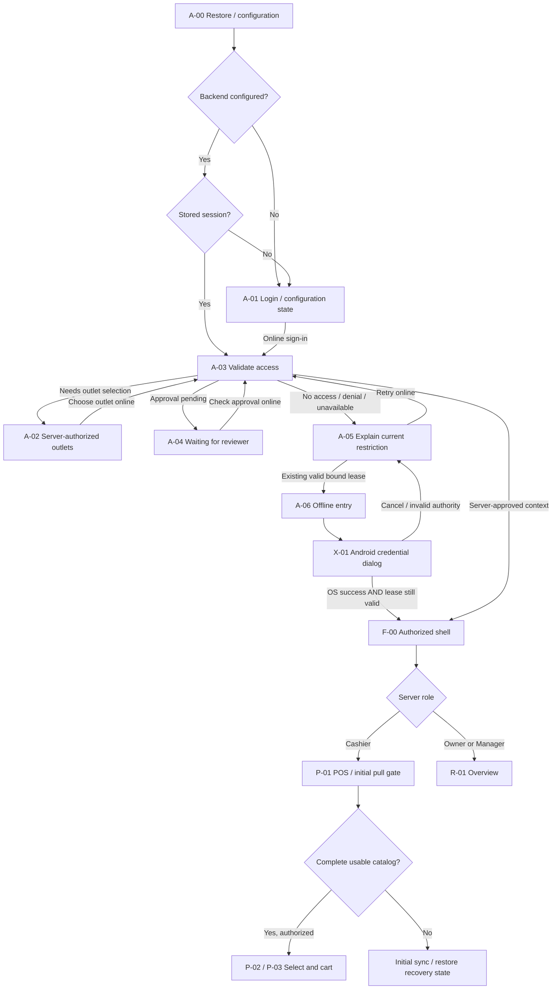
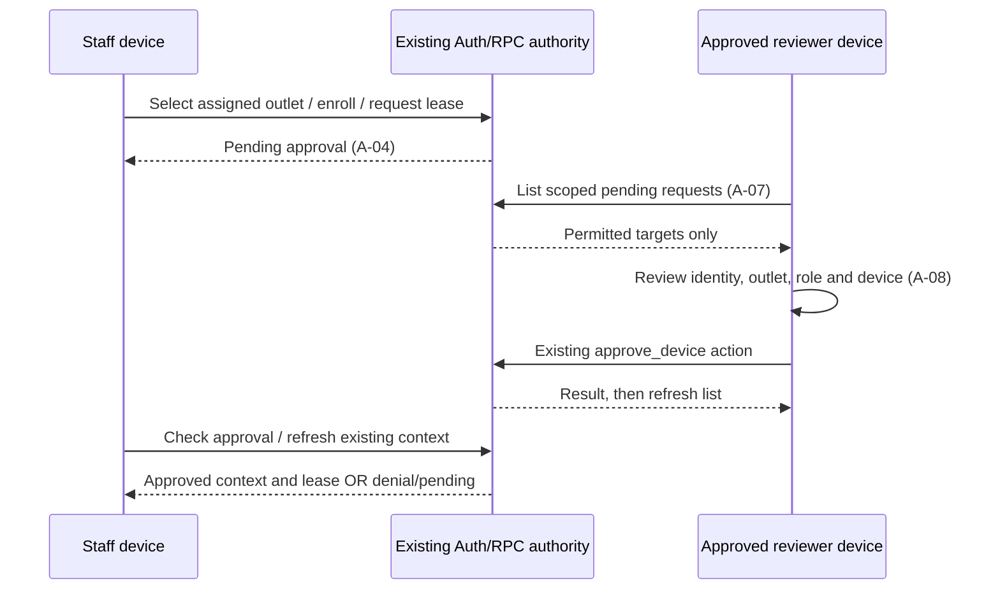
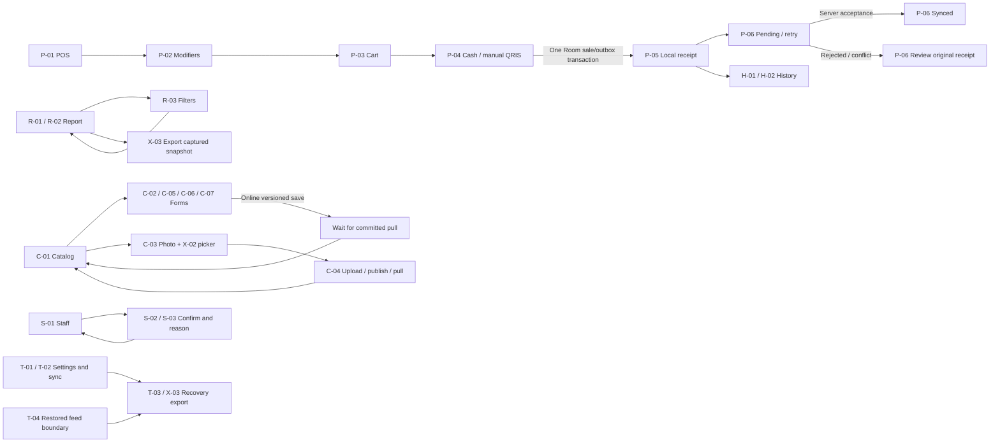

# Screen inventory and implementation plan

15 November 2026 · Daun Teh Nusantara POS · Asterfed

Design handoff, not a claim that the new visual designs are implemented in Android.
Use the [visual guidelines](UI_GUIDELINES.md) for tokens and
[access-flow specification](AUTH_SCREEN_DESIGNS.md) for the first detailed flow.
The [interactive access reference](design/access-flow.html) uses fictional data.
Native access and shared shell presentation are now implemented; see
[SHELL_SCREEN_DESIGNS.md](SHELL_SCREEN_DESIGNS.md). Catalog C-01–C-08 is now detailed in [CATALOG_SCREEN_DESIGNS.md](CATALOG_SCREEN_DESIGNS.md).
Other feature groups remain inventory entries pending their detailed redesign.

## Scope and notation

IDs identify **design surfaces**, not necessarily navigation destinations. A sheet,
inline state or OS dialog should not become a new Compose route just to match an ID.
Several existing states share one composable, and Overview/Reports share report
infrastructure. Reuse that structure where appropriate.

Roles: **O** Owner / Pemilik; **M** Manager / Pengelola; **C** Cashier / Kasir.
“Bound offline” means only the previously authorized device/account/outlet/role,
within its existing lease; it never grants new access or instant offline revocation.
Depth: **Detailed** has a first-flow layout/state/action specification; **Inventory**
has an implementation entry point and state checklist, with detailed design to follow.

## 1. Access — detailed first flow

| ID | Surface / proposed title | Type | Roles | Connectivity / gate | Current implementation anchor |
| --- | --- | --- | --- | --- | --- |
| A-00 | Memeriksa sesi | Startup state | O/M/C | Restore cache, then online validation when possible | AuthRoot, restore |
| A-01 | Masuk | Screen | O/M/C | First login online; configured backend and administrator-created account | LoginScreen, signIn |
| A-02 | Pilih outlet | Screen | O/M/C | Online server memberships; roles are read-only | OUTLETS, selectOutlet |
| A-03 | Memeriksa akses perangkat | Transient state | O/M/C | Server enrollment/approval/lease validation | busy, select/refresh |
| A-04 | Menunggu persetujuan | Locked variant | M/C normally | No checkout; check online approval, keep device identity | DEVICE_PENDING, pendingDeviceId |
| A-05 | Akses belum tersedia | Locked/error variants | O/M/C | No access, denial, temporary failure, invalid/expired offline authority | LOCKED / message / canOffline |
| A-06 | Buka akses offline | Locked variant + OS handoff | O/M/C | Bound offline only; must recheck lease after OS confirmation | canOffline, unlockOffline |
| A-07 | Permintaan perangkat | Section inside Staf | O/M | Online, server-authorized reviewer and outlet | StaffDevicesPanel, loadDeviceRequests |
| A-08 | Setujui perangkat? | Proposed confirmation sheet/dialog | O/M | Owner reviews manager/cashier; manager cashier only | Existing approveDevice action |

Detailed state/action layouts: [AUTH_SCREEN_DESIGNS.md](AUTH_SCREEN_DESIGNS.md).

## 2. Shared shell — detailed / implemented presentation

| ID | Surface | Type | Roles | Connectivity / gate | Anchor / essential states |
| --- | --- | --- | --- | --- | --- |
| F-00 | Role navigation + outlet/status header | Shared shell | O/M/C | Current authorized context | AccessPortal, RoleNavigation; online/offline/busy/scope change |
| F-01 | Ganti outlet | Reuse A-02 | O/M/C | Online; revalidate membership and new device scope | chooseOutlets; unavailable/no choices/cancel/sign-out |

Do not add a role chooser to login. Navigation follows server membership. Owner/
Manager starts at Ringkasan; Cashier starts at Kasir. A READY auth state does not
by itself complete the first catalog catch-up required for cashier checkout.

## 3. Catalog — detailed / implemented presentation

| ID | Surface | Type | Roles | Connectivity / gate | Anchor / essential states |
| --- | --- | --- | --- | --- | --- |
| C-01 | Katalog | Screen + horizontal tabs | O/M | Read cached; edits online and initialized pull | CatalogEditorScreen; loading/empty/offline/error/conflict |
| C-02 | Tambah / Edit produk | Form | O/M | Online, optimistic version, shared-brand scope | CatalogForm; invalid parent/price/groups/save retry/pull wait |
| C-03 | Foto produk | Inline photo actions / preview | O/M | Upload/remove online; reads may be cached | ProductPhoto; absent/loading/failed/retry/cache eviction |
| C-04 | Menyimpan foto | Inline progress/error state | O/M | Existing photo command identity and server photo version | pickPhoto/sendPhoto; invalid file/upload/unknown ACK/conflict |
| C-05 | Kategori | Form | O/M | Online, optimistic version | Category form; empty name/order/archived |
| C-06 | Grup pilihan | Form | O/M | Online, min/max and availability rules | Modifier group form; invalid bounds/required options |
| C-07 | Pilihan | Form | O/M | Online, immutable group parent | Modifier option form; price/parent/archive constraints |
| C-08 | Arsipkan item? | Proposed confirmation | O/M | Existing soft-active change; no physical deletion | Form active flag; shared-brand impact/version conflict |

See [CATALOG_SCREEN_DESIGNS.md](CATALOG_SCREEN_DESIGNS.md) and the
[catalog reference](design/catalog-flow.html) for the proposed native redesign.
The handoff is now applied to native catalog presentation; its HTML remains a
fictional reference. Physical-device and hosted acceptance remain open.

Photo picker is X-02. Automatic square cropping is implemented; an interactive
crop/zoom editor, camera flow and offline photo upload queue are not in this plan.

## 4. Cashier checkout — inventory

| ID | Surface | Type | Roles | Connectivity / gate | Anchor / essential states |
| --- | --- | --- | --- | --- | --- |
| P-01 | Kasir | Screen | C | Authorized scope + complete initial catalog pull; bound offline thereafter | PosScreen; bootstrap/recovery gate/loading/empty/photos missing |
| P-02 | Pilih minuman | Modifier/quantity sheet | C | Current usable catalog and selection rules | Product selection; min/max/unavailable/stale selection |
| P-03 | Keranjang | Compact sheet / expanded pane | C | Durable scoped draft | Quantity/remove/empty/revision conflict/stale cart |
| P-04 | Pembayaran | Focused screen / pane | C | Local atomic checkout; cash/manual QRIS rules | Tender/change/confirmation/invalid/busy/repeat-submit guard |
| P-05 | Struk tersimpan | Receipt | C | Local durable sale success | Original snapshots; pending vs acknowledged sync |
| P-06 | Status penjualan | Receipt detail/inline state | C | Own retained sale scope; server acknowledgment for SYNCED | Pending/retry/auth-required/review; no automatic repricing |

Search/category filtering is a presentation target from the visual guidelines;
verify its current implementation before assigning code tasks. Do not add an Owner
cashier destination or bypass modifier/catalog checks through a shortcut button.

## 5. History — inventory

| ID | Surface | Type | Roles | Connectivity / gate | Anchor / essential states |
| --- | --- | --- | --- | --- | --- |
| H-01 | Riwayat | Screen | C in current navigation | Own authorized history; scoped local/cache data | LocalHistory/AuthenticatedPosRoute; loading/empty/merged/local-only |
| H-02 | Detail struk | Detail surface | Authorized receipt reader | Receipt scope; cached original snapshots | ReceiptContent; local/cloud distinction/review/auth-required |

Manager/Owner reporting does not imply a new cross-outlet receipt-history route.
Do not add void/refund/delete-sale controls without the separate business policy.

## 6. Overview and reports — inventory

| ID | Surface | Type | Roles | Connectivity / gate | Anchor / essential states |
| --- | --- | --- | --- | --- | --- |
| R-01 | Ringkasan | Screen, shares report data | O/M | Owner brand / manager assigned outlet; authorized cached report | ReportRoute; loading/empty/cached/as-of/error |
| R-02 | Laporan | Screen | O/M | Same scope; server-accepted sales only | Period/daily/outlet/product sections; no profit/bank-verification claim |
| R-03 | Filter laporan | Inline controls / proposed sheet | O/M | Valid Jakarta date range; owner outlet choices scoped | ReportQuery; invalid date/range/refresh/preserve selection |

Export uses X-03 with the captured report snapshot. Do not invent new metrics,
inventory data or backend endpoints for a more decorative dashboard.

## 7. Staff and device access — inventory

| ID | Surface | Type | Roles | Connectivity / gate | Anchor / essential states |
| --- | --- | --- | --- | --- | --- |
| S-01 | Staf | Screen | O/M | Online scoped roster | StaffRoute; loading/empty/retry/role-limited actions/manual provisioning |
| S-02 | Ubah akses outlet? | Confirmation + reason | O/M | Live target authorization and expected version | No self/owner/foreign target; reason/409/revoke implications |
| S-03 | Ubah akses perangkat? | Confirmation + reason | O/M, owner-only restore | Live proof/target/version | Revoke vs restore-to-pending; no automatic reapproval |

A-07/A-08 are the device-approval section/dialog inside this flow. Do not create a
public signup/invitation or in-app Auth-account creation surface.

## 8. Settings and recovery — inventory

| ID | Surface | Type | Roles | Connectivity / gate | Anchor / essential states |
| --- | --- | --- | --- | --- | --- |
| T-01 | Setelan | Screen | O/M/C | Current authorized account/device | Account/outlet/sync/device/recovery sections, sign-out |
| T-02 | Status sinkronisasi | Inline section/detail | O/M/C | Retained own scope; online delivery for push/pull | SyncStatusPanel; pending/retry/review/last success |
| T-03 | Ekspor data perangkat | Recovery action/state | Authorized current scope | Retained real work; X-03 for destination | Preparing/size bound/cancel/provider failure/complete |
| T-04 | Data server dipulihkan | Blocking data-state + recovery context | Affected authorized user | Restored epoch mismatch, retained work preserved | REBOOTSTRAP_REQUIRED; export/contact operator, no app-data clearing |

## 9. OS boundaries — platform owned

| ID | Surface | Type | Entry | Design responsibility |
| --- | --- | --- | --- | --- |
| X-01 | Android device-credential confirmation | OS UI | A-06 | App launches intent, handles cancel/result, rechecks lease; never collects device PIN |
| X-02 | Android Photo Picker / document fallback | OS UI | C-03 | Handle selection/cancel/permission/provider/process loss; no custom gallery needed |
| X-03 | Android document destination picker | OS UI | Report/recovery export | Preserve selected snapshot, handle cancel/write failure; no custom file manager |

## 10. Flow maps

### Access and operational entry

The offline edge is available only where current `canOffline` permits it; no-access,
confirmed denial, missing approval, expired/invalid lease or new device must not gain
that edge. Resume can reuse a previous outlet only after existing validation rules.

### Device approval across two actors

Approval is not a self-service staff toggle, nor guaranteed immediate push delivery.
Owner may approve manager/cashier; a manager may approve only cashier requests in
an authorized outlet. A new Owner device may self-enroll under server policy;
revoked/denied devices do not bypass server validation because the user is Owner.

### Sale, sync and management journeys

## 11. Design and implementation sequence

| Step | Design deliverable | Implementation boundary / acceptance |
| --- | --- | --- |
| 0 | Shared tokens/components from UI_GUIDELINES | Typography/shapes/spacing/icon conventions; no business-state changes |
| 1 | **Detailed now:** A-00–A-08 and X-01 | Login/outlet/pending/locked/offline/review screens; preserve existing authority rules |
| 2 | F-00/F-01 | Distinct role-filtered navigation icons and compact outlet/status header |
| 3 | C-01–C-08 | Catalog tabs/forms/photos; existing version, retry and brand scope |
| 4 | P-01–P-06 | POS/cart/payment/receipt; initial pull, atomic save and duplicate-submit protection |
| 5 | H-01/H-02 | Own receipt history, local/cloud/review distinctions |
| 6 | R-01–R-03 | Scoped cached/accepted-server reporting, filters/export |
| 7 | S-01–S-03, T-01–T-04 | Staff/access/recovery actions and confirmations |

Do one connected implementation iteration at a time. Design completion is not code
completion, security acceptance or production approval. Remaining flows need detailed
phone/tablet/state designs before their implementation pass.

## 12. Definition of ready for each flow

- Entry/exit, role/outlet source and online/offline prerequisites are named.
- Phone and tablet composition, type/icon/color roles and reusable components are specified.
- Every meaningful loading, empty, validation, retry, conflict and denial state has copy/actions.
- UI-only selection/visibility state is separated from domain/server authority.
- OS dialogs are marked as boundaries, with cancel/resume behavior.
- Acceptance scenarios identify relevant existing domain/DAO/native tests and new checks needed.
- No new backend contract, credentials, recovery shortcut or business policy is implied.
- A design review can identify what the next implementation task changes and what must be verified.

F-00/F-01 native handoff and acceptance: [SHELL_SCREEN_DESIGNS.md](SHELL_SCREEN_DESIGNS.md).

## POS detailed handoff — 15 November 2026

P-01–P-06 is now detailed in [POS_SCREEN_DESIGNS.md](POS_SCREEN_DESIGNS.md) and
[design/pos-flow.html](design/pos-flow.html). Design handoff and native presentation are complete, with physical/hosted acceptance
still open. POS-UI-01–05 covers scope/result state, selection/cart, payment/receipt,
scoped delivery projection and regression checks; see the verification status below.

Native POS-UI-01–04 presentation is implemented; POS-UI-05 host checks and physical/
hosted limitations are tracked in PROGRESS.md and POS_SCREEN_DESIGNS.md section 10.
The next screen-design group is transaction history H-01/H-02; no adjustment or
printing feature is implied. Existing M7 acceptance gates remain open.

## History detailed handoff — 15 November 2026

H-01/H-02 now has detailed layouts, state/action contracts and implementation
tickets in [HISTORY_SCREEN_DESIGNS.md](HISTORY_SCREEN_DESIGNS.md), plus a fictional
[phone/tablet reference](design/history-flow.html). Design handoff is complete;
HIST-UI-01–04 native presentation is next. Preserve cashier-only navigation, own
scoped cached receipts, original snapshots and separate delivery proof. No archive
completeness, pagination, refund/void, printing or new management route is implied.

Native HIST-UI-01–03 presentation is implemented, with HIST-UI-04 verification in
PROGRESS.md and remaining manual checks in HISTORY_SCREEN_DESIGNS.md section 7.
Next screen-design group: overview/reports/filters R-01–R-03, preserving server-
accepted metrics and existing X-03 export. M7 hosted/signing/recovery gates remain open.

## Overview/report detailed handoff — 15 November 2026

R-01–R-03 and report X-03 now have [detailed designs](REPORT_SCREEN_DESIGNS.md), a
[local interactive reference](design/report-flow.html) and RPT-UI-01–04 native tickets.
Design handoff is complete; native report redesign is next. Existing metric/query/
cache/CSV contracts remain authoritative. No new chart/metric, endpoint, public route,
permission, discount entry, refund or archive capability is added by these artifacts.

## Native report presentation — 15 November 2026

RPT-UI-01–03 now implement the shared overview/report session, draft filter sheet,
responsive metrics/rows, exact-query cache and guarded captured export. RPT-UI-04
verification is recorded in PROGRESS.md; outstanding normal-app/device/provider
acceptance is in REPORT_SCREEN_DESIGNS.md section 7. The HTML remains a fictional
reference. Next: detail S-01–S-03 staff/access/confirmation screens; manual provisioning,
existing authorization and M7 hosted/signing/recovery gates remain unchanged.

## Staff/access detailed handoff — 15 November 2026

S-01–S-03 now has [detailed layouts and state contracts](STAFF_SCREEN_DESIGNS.md), a
[fictional interactive reference](design/staff-flow.html), and phone/tablet captures.
Manual provisioning, outlet-only roster, Owner/Manager permissions, profile versus
membership, revoke/restore-to-pending, separate approval and bounded audit remain.
Next: native STAFF-UI-01–04, with request/scope guards and explicit ack/readback/
uncertain/conflict behavior. No Android/backend/schema changes in this design step.

## Native staff/access presentation — 15 November 2026

STAFF-UI-01–03 now implement scoped sessions, adaptive roster/device/audit views,
versioned reasoned confirmations, separate approval and ack/readback/uncertain states.
STAFF-UI-04 checks are recorded in PROGRESS.md; normal-app/hosted/device limits remain
in STAFF_SCREEN_DESIGNS.md section 9. Next: T-01–T-04 settings/recovery/sign-out and
existing X-03 recovery export detailed designs, preserving current recovery boundaries.

## Settings/recovery detailed handoff — 15 November 2026

T-01–T-04, sign-out and recovery X-03 now have [detailed designs](SETTINGS_SCREEN_DESIGNS.md),
a [fictional interactive reference](design/settings-flow.html) and phone/tablet captures.
Next: native SETTINGS-UI-01–04. Preserve current archive/sync/auth contracts; add scoped
read/IO guards, captured export lifecycle and reasoned sign-out presentation. No new
reset/import/restore/admin/password/backup configuration or Android behavior this step.

## Native settings/recovery presentation — 15 November 2026

SETTINGS-UI-01–03 now implement scoped adaptive settings, guarded push/pull observation,
validated captured export and sign-out confirmation. SETTINGS-UI-04 checks and limits
are recorded in PROGRESS.md / SETTINGS_SCREEN_DESIGNS.md section 9. All planned native
screen groups now have presentation implementations; this does not close hosted,
normal-app/provider, physical accessibility, recovery or signing acceptance. Next:
cross-screen normal-application phone acceptance and M7 release checklist review.
